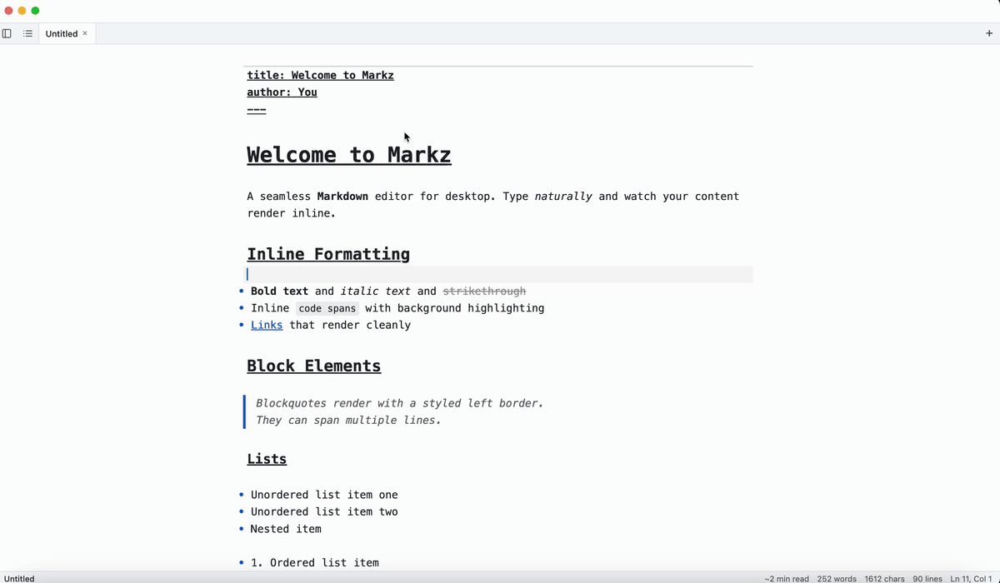
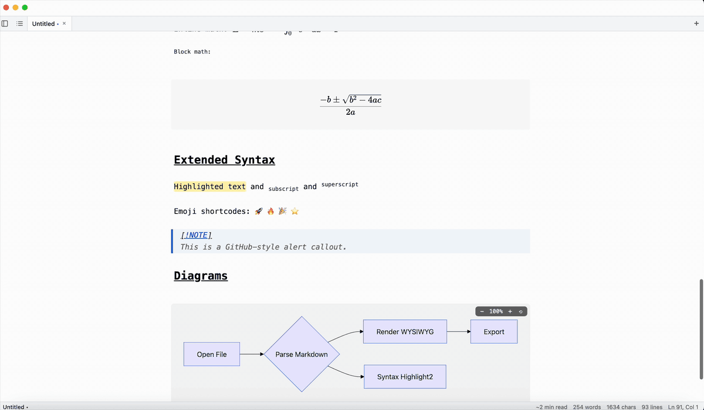

# Markz

Markz is a desktop Markdown editor. You type normal Markdown syntax; the document renders inline as you work. There is no separate preview pane to flip between.

See [Release Notes](docs/RELEASE_NOTES.md) and [Changelog](CHANGELOG.md).

[](https://github.com/CodingTumbleweed/markz/releases/latest)
[](LICENSE)

## Download

> **Before you install**
>
> Markz beta builds are **unsigned**. macOS Gatekeeper and Windows SmartScreen may warn or block the app the first time you open it.
>
> **[Installation guide →](docs/INSTALL.md)** platform steps and checksum verification

Pick a build from **[GitHub Releases](https://github.com/CodingTumbleweed/markz/releases/latest)**:

| Platform | Download |
|----------|----------|
| macOS (Apple Silicon) | `Markz-*-arm64.dmg` |
| macOS (Intel) | `Markz-*-x64.dmg` |
| Windows | `Markz-Setup-*.exe` |
| Linux | `Markz-*.AppImage` or `markz_*_amd64.deb` |

## Markdown in the editor

The line under your cursor stays as Markdown source. Everything else is styled text, so you can scan the page without a preview split.



- Headings, **bold**, *italic*, links, blockquotes, and lists
- Code blocks with highlighting, GFM tables, KaTeX math
- Mermaid diagrams, alerts, and other extended syntax in the same view
- Usual shortcuts: `Cmd+B` / `Cmd+I` / `Cmd+K` (Windows/Linux: `Ctrl+…`)

## Files, themes, and export

Open a folder in the sidebar, jump between files with tabs, and use `Cmd+P` to open anything quickly.



- Folder tree or flat file list
- Multiple tabs with per-tab undo
- Themes (GitHub, Newsprint, Minimal) and light/dark/auto in preferences (`Cmd+,`)
- Export to PDF or HTML (`Cmd+Shift+E`)

## Development

- **Stack** — Electron, TypeScript
- **Build** — esbuild (main/preload), Vite (UI)
- **Requires** — Node.js 20+, npm 10+

```bash
git clone https://github.com/CodingTumbleweed/markz.git
cd markz
npm install

npm run dev              # dev: esbuild + Vite + Electron window
npm run build            # production bundle
npm run package:mac      # local installer → release/ (also :win, :linux)
```


## License

Released under the [MIT License](LICENSE).